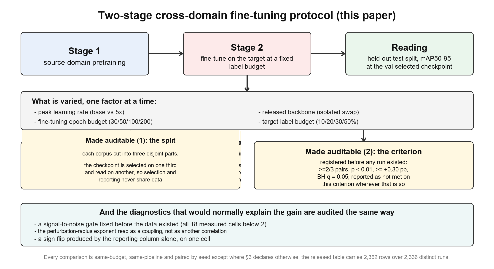
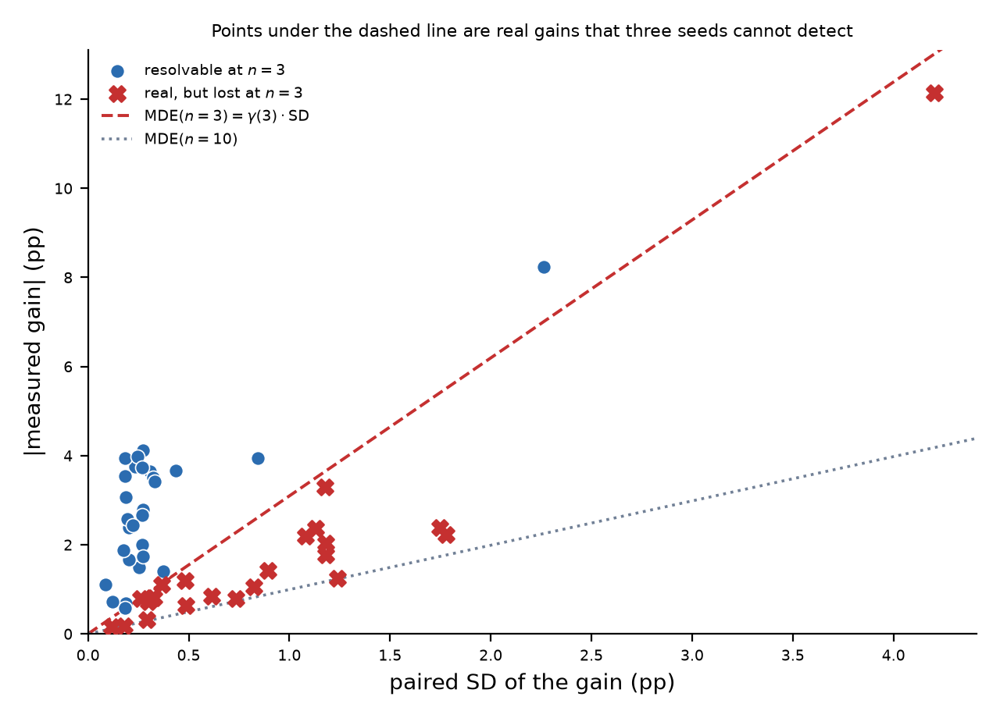

# Budget, not domain: how annotation budget moves a transfer gain, and why three seeds often cannot measure it

**Every quantitative claim the argument rests on carries a verification tag** (definitions, scope remarks and restatements do not). **✅CONFIRMED** means the number is traceable to a **recorded evidence path**, of a recorded evidence path — either **recomputation from the released per-run tables** (§4 and §5) or an **archived measurement** (§6, whose numbers come from perturbation, spectral and split measurements rather than from repeated training). Every ✅CONFIRMED number states **which seed set it uses**; where a cell has ten paired seeds and the reported figure rests on a subset, the subset is named. **No number in this draft carries ⚠PENDING**: the label axis, previously marked so, is reported in §4.6.*

---

## Abstract

Cross-domain fine-tuning of a lightweight detector loses target accuracy, and the standard response is to find a better transfer method. We take the opposite view: under a fixed annotation budget, the quantity that co-varies with whether a transfer gain survives is **the budget itself** — and on the graded cells we measure we do not identify it as the cause. On the same data pair and the same pipeline, extending fine-tuning from 100 to 200 epochs reduces the gain of a 5× peak learning rate without removing it: **+3.727 → +2.584 pp** (mAP50-95, ten of ten paired seeds lower), and on a second pair **+0.168 → −0.055 pp** ✅CONFIRMED (a third pair meets neither the significance nor the direction requirement of the registration; §5). A same-pair four-point sweep reads **+3.656/+2.674/+1.666/+1.495 pp** at 30/50/100/200 epochs (endpoint difference **−2.161 pp**, t = −17.52) ✅CONFIRMED. Re-run on a **clean three-way split**, where checkpoint selection and reporting use different directories, the 100-to-200 change is **−1.138 pp** — within **0.005 pp** of the **−1.143 pp** above and **3.9× its own MDE**. We therefore treat annotation budget as **the measured independent variable** and report the protocol that makes the measurement auditable: paired seeds, a pre-registered multi-target replication with a frozen magnitude bar, and a three-way split that separates checkpoint selection from reporting. The replication fails its own magnitude bar on two of three pairs while succeeding in direction — we report that as the result. **A second result concerns measurement, and it is the one we would most want read.** Treating the ten-seed cells of a frozen 2,362-run archive as ground truth, **51 gains are resolvable at ten paired seeds but only 28 at three** — so **45% of the gains that are real would go undetected** at the seed count most studies use. The median minimum detectable effect is **1.000 pp at n = 3** and **0.321 pp at n = 10**, against a median measured magnitude of **1.581 pp**. **The losses are not confined to small effects**: the largest gain in the archive, **+12.14 pp**, is among them, because its paired SD is **4.20 pp**. **Variance, not effect size, is what defeats three seeds** — the same quantity that destabilises the sign of a budget contrast. A companion audit shows that first-order geometry diagnostics of the kind the literature uses to explain such gains **could not be used on any of the 18 cells we measured**: signal-to-noise below 2 throughout, and a sign flip of the diagnostic under a change of the *reporting* checkpoint alone ✅CONFIRMED.

**Keywords:** cross-domain detection; annotation budget; budgeted fine-tuning; measurement protocol; evaluation audit

---

## 1. Introduction

A detector pretrained on a source domain and fine-tuned on a target domain loses accuracy on that target, and the literature has produced a large methodological response: alignment, adversarial adaptation, reconstruction, distillation (surveys: [1], [2]). That response shares one unexamined assumption — that the *method* is the object worth varying. In deployment the binding constraint is usually not the method but the **annotation budget**: a fixed number of labelled target images, a fixed number of fine-tuning epochs. We ask what that constraint does to the conclusions.

Our claim is narrow and testable: **on the pairs we measure, the sign of a transfer gain moves with the remaining budget** — the annotation-budget axis in the detection setting already carries that observation, reported by [18] (Zhang, Xu & Agrawal, arXiv:2606.30795) as the sign of an intervention's gain changing with the labelled budget, so what is new in this paper is not *that* a sign can change but **which** intervention moves it, under which pairing, and on what criterion the change is admitted (§2, §4.6). We do not claim to have identified budget *rather than* domain as the cause: on the largest-gain cell the two covary, and the separating design is not among these cells (§8). Concretely, a larger peak learning rate that helps a cross-domain pair at 20% labels and 100 epochs *stops helping* — and in one pair *starts hurting* — at 200 epochs, with pretraining, pipeline, split and seed set fixed ✅CONFIRMED.

Three consequences follow, and they organise the paper:

1. **The measured variable is budget** (§3, §4). We run the same pair at four budgets, paired by seed, and report the change in gain rather than the gain.
2. **At the seed counts most studies use, a large share of real transfer gains is not measurable** (§9). On the **60 cells that carry at least ten paired seeds**, taking the ten-seed value as reference, **51 are resolvable at ten paired seeds but only 28 at three** — so **45% of the gains that are real would go undetected** at the usual seed count. The median minimum detectable effect is **1.000 pp at n = 3** against **0.321 pp at n = 10**, while the median measured magnitude is **1.581 pp**. **The losses are not confined to small effects** — the largest gain in the archive, **+12.14 pp**, is among them, because its paired SD is **4.20 pp**. What defeats three seeds is **uncontrolled variance, not a small effect**, and that is the same quantity that destabilises the sign of a budget contrast. 
3. **The measurement must be auditable** (§5). Selection and reporting are separated by a three-way split; the confirmatory analysis is a pre-registered multi-target replication whose criterion (direction **and** significance **and** a magnitude bar) was frozen before its runs existed. It fails on magnitude for two of three pairs.
4. **The diagnostics usually offered for such gains do not survive the audit** (§6). The first-order geometry quantities used to explain transfer gains are trajectory-evaluated and evaluator-sensitive: below the noise floor on every measured cell, and sign-flipping under a change of the reporting checkpoint alone ✅CONFIRMED.

We do not propose a transfer method, and we claim no new bound or architecture. What we offer is a **measured, auditable statement about when a transfer gain exists at all**, together with the protocol and the audit that establish it. **The practical consequence is a reporting rule**: a transfer gain should be stated with the seed count and the minimum detectable effect it was measured against, because a gain below that threshold is not a small effect but **an unmeasured one**.

---

## 2. Related work and positioning

**Cross-domain detection is a method literature.** [1] surveys unsupervised adaptation of detectors; [2] classifies the field into feature alignment, adversarial training, reconstruction and distillation. Both frame label scarcity as the problem a method must solve. We frame it as the quantity to be measured.

**Benchmarks in this area vary the distribution, not the budget.** The cross-domain document-detection suite [3] varies document domains; the RWDS suite [4] varies climate zone, disaster type and geography for domain generalisation. Both are data suites whose independent variable is the domain. Ours is the annotation budget.

**Evaluation audits are a recognised genre, and we follow its conventions.** LeakageBench [5] states its aim as separating model performance from information leakage and making a pass/warning/block decision auditable — explicitly *not* introducing a predictive algorithm. Datasheets and model cards [6][7] established documentation practice for datasets and models. The variance accounting of [8] is the methodological base we build on: variance from data sampling, initialisation and hyperparameter choice markedly affects benchmark conclusions, and their recommendation is to spend variation budget deliberately. Our paired-seed, multi-budget design is that recommendation applied to a detection fine-tuning campaign.

**Statistics are already used to predict transfer, and backbones are already compared.** Two strands of prior work bound what our §4.4 can claim as new. First, transfer difficulty has been predicted from **label statistics without training a model** — from the conditional entropy between source and target label assignments, shown to relate to the loss of the transferred model [9] — and, on the model side, the accuracy of a source model has been used to predict how well it transfers [10]; both are the same move we make in §9, where a **corpus** statistic is read as a moderator, and they differ from it in the statistic (conditional entropy; source accuracy), the dependent variable (transfer loss or hardness; accuracy) and the setting (classification). Second, the **backbone** has been treated as an isolated independent variable inside detection before: varying only the backbone on one dataset [11], and, closest to our protocol, holding the corpus, the split and *the number of epochs* fixed across six backbones before tuning hyperparameters [12].

**The budget dependence of the optimum is known; its *sign* is not.** The optimal learning rate moves with the training horizon and follows a scaling law [13]; the optimal effective rate moves with source–target similarity [14]; and fine-tuning instability has been attributed to the number of training iterations rather than to the amount of data [15]. **Two recent results report a reversal rather than a shift**: extending the *pretraining* budget can make models harder to fine-tune [16], and the preferred optimizer and its optimal hyperparameters change substantially — in places reversing — along the **overtraining** axis [17]. Closest to us in the detection setting, a sparse-label budget sweep over a source-free adaptation pipeline reports that **the sign of an intervention's gain changes with the labelled budget, and attributes it to the headroom that direct supervision leaves** [18]; **A separate line already argues that an apparent transfer gain need not come from transfer**: ImageNet pretraining speeds convergence without necessarily improving final accuracy [19], part of the transfer difference is over-parametrisation rather than feature reuse [20], fine-tuning only the batch-normalisation affine parameters matches full fine-tuning [21], a stronger training protocol can beat the pretraining source with detection included [22], and direct pretraining on the target corpus has been reported to beat ImageNet pretraining on COCO by 1.8 mAP [23]. We treat that line as the *context* of our §4 same-domain reading rather than as a competitor to it, because those works compare **pretraining sources or training components** for a single model, whereas what is measured here is the **sign of one strategy's paired gain** as the budget moves, with the pair, the pipeline and the seeds fixed. **What this paper is not.** It is not another transfer method, and it does not compete on target accuracy. Where this literature asks which method wins, we ask a prior question — **whether the gain being reported can be measured at all, and on what budget** — and we answer it with a paired-gain design plus the resolution arithmetic that says when the answer is decidable. **The searches recorded with this submission did not return such a paired-gain measurement for detection** (the search record is reported with this submission, and Appendix O.3 states what the channels reached).

---

## 3. Design

**Setting.** A two-stage protocol: source-domain pretraining, then fine-tuning on a target domain with a fixed fraction of its labels, at a fixed number of epochs. Unless a cell says otherwise the detector is **YOLOv12n** [24] trained with the **shape-IoU** loss, scored by the mAP50-95 definition with the **Ultralytics 8.4.120 `val` implementation** as the concrete evaluator in every run (named rather than cited: the definition is a library convention, not a source); **the headline contrast survives an independent implementation**: re-scoring the same runs’ predictions with **official `pycocotools`** moves the level **0.51 pp** but the **paired gain only 0.25 pp**, inside its MDE (U); **2,241 of the 2,362 rows** of the released table use that backbone (the table’s 2,362 rows carry 2,336 distinct run names, the 26 extra rows being repeat records of the same runs), the remainder being the two comparison generations (the residual 31 rows carry an unrecorded backbone and are excluded from the backbone comparison) of §4.4 (`yolo11n`, **76 runs**; `yolo26n`, **14 runs**), which are described there. Every comparison is same-budget, same-pipeline and paired by seed — **with one declared exception: in 9 of the 165 cells that carry both arms the two arms' seed kinds are not the same set (165 is the two-arm count over cells with a parseable label budget, three fewer than the 168 two-arm cells P.9 reports before that filter)** — a denominator distinct from the 168 paired cells quoted elsewhere, and counted per cell on the released table so that a reader can reproduce it (Appendix P.8(iii)), and the §4.1 rows pair across families rather than within one (stated there). Gains are percentage points of mAP50-95. **Two reporting columns appear in this paper and their roles are fixed here**: the **held-out test column** is the primary one, read wherever a subsection does not say otherwise, and the **validation-selected best-checkpoint column** is a **sensitivity** column; a subsection that reads the second says so, and the numbers it reports there are sensitivity readings rather than the primary ones (Appendix R collects the convention and the exceptions). The corpora are the public detection datasets used as sources and targets throughout: SHWD [25] and SFCHD [26] for the helmet-detection cells, VisDrone [27], DOTA [28] and AI-TOD [29] for the aerial cells, with the remaining target corpora named where they first appear. Their per-corpus roles, split statistics and provenance are in Appendix L. **Fig. 1** schematises this two-stage pipeline and the four factors that are varied one at a time.

**Fig. 1.** Two-stage protocol schematic — source-domain pretraining, then fine-tuning on the target at a fixed label budget, read on the held-out test split at the validation-selected checkpoint. Below: the four factors varied one at a time (peak learning rate, epoch budget, label budget, released backbone); the two devices that make it auditable (a three-way split separating selection from reporting, and a criterion registered before the runs existed); and the audit applied to the first-order diagnostics. **Column conventions, audit placement and the caption’s exceptions: Appendix R.**

**Two axes, deliberately separated.**

| Axis | Operation | What it tests |
|---|---|---|
| **Budget in epochs** | re-run the same pair at 100 vs 200 epochs | whether a gain survives more optimisation |
| **Budget in labels** | re-run the same pair at 10/20/30/50% of target labels | whether a gain survives less supervision |

These are different independent variables and must not be conflated: one moves the *remaining* budget, the other the *available* labels.

**Replication and its criterion.** The multi-target replication was registered before any of its runs existed. It fixes three unsaturated target domains, a 20% label budget, one detector, and a criterion, quoted as registered, of **≥2/3 pairs meeting all three of: a paired significance level of p < 0.01, at least eight of ten seeds moving in the same direction, and an effect size of ≥ +0.30 pp**, under a Benjamini–Hochberg correction at q = 0.05 (registration, criterion and archive: supplement, Appendix N.1). The frozen magnitude bar is the part of that criterion we could not find precedent for in the literature.

**Three-way split.** Where the protocol is our own, the checkpoint is selected on one third of the corpus and read out on another, so selection and reporting never share data; re-keying a cell from its selection third to its reporting third moves the reading by −0.069 pp (p = 0.825) ✅CONFIRMED. **For some cited published cells the reported test reading is not an independent held-out one**: either the released `test:` key also selected the checkpoint or `test:` and `val:` point at the **same directory** (`mech` is the second kind; Appendix M.3 lists both kinds). The criterion is §3’s column convention, not a cell count; the split construction and the checkpoint-selection audit are in Appendix N.2.

---

## 4. Result: the gain falls, and its sign can change

**4.1 The intervention.** Two cells carrying the largest gains were re-run at 200 epochs, ten seeds per arm, same pretraining, data and pipeline; **the rows are different pairs and their endpoints pair across families (`t1c`/`t1b` against `mech`), stated because elsewhere this paper decomposes only within one family** (Appendix P.10).

| Cell | 100 epochs | 200 epochs | Δ gain | seeds lower | paired t |
|---|---|---|---|---:|---:|
| `visdrone→dota15` | **+3.727 pp** | **+2.584 pp** | **−1.143 pp** | **10/10** | **−14.50** |
| `aitod→visdrone` | **+0.168 pp** | **−0.055 pp** | **−0.223 pp** | 9/10 | **−5.12** |

✅CONFIRMED (paired, per-seed recomputation). The direction is what a headroom account predicts — more budget, less remaining headroom, smaller gain — and it is the **opposite** of what "the strategy arm simply needed longer to converge" predicts. Three limits belong to this table: the intervention was decided **after** the results above (its analysis criteria were frozen before its runs, but the decision to run it was not); it covers **two cells at one budget interval**; and **both endpoints of the first row are read on the registered column, which on this pair is not an independent held-out split**: `mech` at 200 epochs and its 100-epoch counterpart both use `dota15_20p.yaml`, where the `test` and `val` entries name **the same directory**, so that column selects the checkpoint and then reports on it. **The clean three-way protocol reproduces this result.** The clean 100-epoch reading is **+3.652 pp** (a separate family on `dota15_20p_3way.yaml`, ten seeds) and the clean 200-epoch counterpart is **+2.514 pp**, so the **like-for-like clean difference is −1.138 pp** (SD 0.2951, **t = −12.2**) — within **0.005 pp** of the **−1.143 pp** above and **3.9× its own MDE**. **The two clean endpoints share one training set and the two registered-column endpoints share another**, but the two groups do **not** train on identical images; the clean reading above is therefore a re-run of the budget comparison, not an isolated test of the split (M.5, **M.5-bis** for the per-run table, R). **Its composition matters**: the **+3.727 pp** aggregate for `visdrone→dota15` is carried by **medium and large objects** (**+3.66** and **+5.89 pp**), while `small-vehicle` — the class that dominates these dense aerial corpora — gains **+0.99 pp** (T.2, T.3), so a bare percentage **overstates what a small-object detector gains**. Those stratified figures are read in this paper’s own recomputation; under the **official `pycocotools`** the same cells gain **+0.61 / +2.43 / +8.00 pp** by size (**U.2**), so the **ordering is implementation-independent while the magnitudes are not**. And **the second row’s sign reversal is a test-column statement**. On the val-best column that cell runs **+1.152 pp at 100 epochs and +0.873 pp at 200**, so it falls without changing sign. The first row behaves the same way on that column (**+3.733 → +2.588 pp**, **Δ = −1.145 pp**, ten of ten seeds lower), so both rows fall without changing sign on the val-best column and the sign change occurs only in the test column.

**4.2 The curve.** A same-pair sweep at four budgets, ten paired seeds throughout:

| Budget | 30 ep | 50 ep | 100 ep | 200 ep |
|---|---|---|---|---|
| `smoke→SFCHD` | **+3.656** | **+2.674** | **+1.666** | **+1.495** |
| `shwd2sf` | **+0.812** | **+0.728** | **+0.694** | **+0.794** |

✅CONFIRMED. The first row gives the decreasing-gain prediction a **10-seed** basis, an endpoint difference of **−2.161 pp (t = −17.52, SD 0.391, ten of ten seeds lower)**, and a **monotone** descent at **every** step: 30→50 epochs **−0.98 pp** (ten of ten seeds lower), 50→100 **−1.01 pp** (ten of ten) and 100→200 **−0.17 pp** (eight of ten). The tenth seed is the row's one point whose run is an **archived snapshot rather than a live directory**: the 30-epoch cell's `s50` pair finished its epochs but was renamed as an interrupted snapshot and never wrote its own test row, so its reading comes from a single re-evaluation under the driver's own selection rule (`best.pt`, the run's own `data` yaml, `split='test'`) and is carried by the released table; its gain **+4.604 pp** matches the value recomputed from that table (**+4.600 pp**, which stores the cell to four decimals), and the reading, both weight digests and the command are archived. The other points rest on ten live-directory seeds. That batch holds 133 runs, 112 with a test reading (84%); the rest is archived intermediate material. The second row does not: on that cell the fourth point **stops falling** (it sits 0.100 pp above the 100-epoch reading), and the 30-versus-200 endpoint difference is **−0.018 pp (t = −0.185, p = 0.86)** ✅CONFIRMED. We report the second row as a **bound, not a direction**. Its **observed** spread over the four budgets is **0.12 pp** (+0.694 to +0.812) — a description of this sweep, not an inference; the **inferential** bound carries the seed variation, so at ten paired seeds and reading SD 0.321 pp the 95% half-width is **±0.23 pp**, and a modulation of 0.31 pp or more would have been detected at 80% power on the endpoint difference (per-seed SD 0.308 pp ⇒ MDE 0.306 pp) ✅CONFIRMED. The half-width is not an equivalence claim. **No other cell supports a bound at this standard**: of the 45 paired epoch-axis differences only **two** reach an MDE of 0.31 pp or below — this one, and a same-domain cell (`dota15→dota15`, 100→200 epochs, **−0.066 pp** at MDE 0.229 pp) — so a bounded null is a result this design can produce at one cross-domain cell, not a claim available archive-wide. **This row is where we differ most from the quantitative budget literature**: the scaling laws fitted to transfer report a *power law in the fine-tuning data size* with no sign change and no bound within the low-data regime the fit covers (the source's own §3.1 asks whether pre-training can harm performance) [30], and the reversal results are stated on the *pretraining* budget axis [16][17]. What is measured here is a **paired gain on one pair across the fine-tuning epoch axis**, with a **bounded null** on the second cell rather than another fitted curve.

**4.3 The saturated control.** On a target already saturated the same larger rate **damages** it. On this subsection's declared column, the validation-selected best-checkpoint column, `mask→mendeley` reads **−1.43 pp** (t = −6.69, p < 0.001, ten of ten seeds lower, ten paired seeds) ✅CONFIRMED — the sign the budget account predicts, obtained without any budget intervention. A **second, independent batch** on the same target (13 paired seeds) **does not reproduce that reading on the declared column**: it reads **+0.004 pp** (t = +0.02, seven of thirteen seeds negative), a null rather than a damage. On the **held-out test column — this paper’s declared convention — the two batches agree** (**−1.17 pp**, t = −3.39, against **−1.16 pp**, t = −3.03), so the damage **reproduces across two independent batches there**; what fails to reproduce is the val-selected reading this subsection had declared for itself. The damage is thus **supported on the paper’s own column, and on the val-selected column by one batch only**. The per-batch, per-column table and the relation to §6(b)'s column sensitivity are in Appendix P.7.

**4.4 A second backbone — and, on the primary target's corpus, an isolated backbone swap.** The direction also holds on a second pipeline. On the `yolo11n`-based [31] `y11_shwd→sfchd` pair the gain is **+1.10 pp** (t = 9.44) at 30 epochs on the **validation-selected best-checkpoint column this subsection reads**, ten paired permutations from batch `y11` (the same reading on the test column is **+1.11 pp**, t = 9.60). At 100 epochs it is close to zero: **+0.19 pp** (t = 2.00) when the readings of the two batches that touch this pair are pooled — **the pool is **ten** entries: the three seeds both batches carry (42–44) are read from `y11` and seven from `b2`, which gives **+0.19 pp** (t = 2.00) rather than `b2`’s own **+0.32 pp**, and all thirteen entries would give +0.25 pp; pooling across batches is used nowhere else in this paper (§4.5 and §4.6 pool only within a family), so we state it here** — **+0.32 pp** on batch `b2` alone (n = 10) and **−0.005 pp** on batch `y11` alone (n = 3, |t| = 0.10). The readings differ, because a batch is a training run of its own; what holds on **all three** is the qualitative reading we rely on — on this backbone the gain collapses between 30 and 100 epochs. The same pair also carries a **third backbone generation** (`yolo26n` [32], batch `y26`) on the same corpus and target: on the three permutations all three generations share (s42–s44), the val-best gains are **+0.92 / +1.27 / +2.64 pp** at 30 epochs and **+0.68 / −0.005 / +1.50 pp** at 100 epochs, and the test-column gains **+0.92 / +1.29 / +2.66 pp** and **+0.68 / +0.010 / +1.49 pp**, for `yolo12n` / `yolo11n` / `yolo26n` respectively — no generation is significantly negative — **the 100-epoch value itself sits inside its own 80%-power minimum detectable difference (|Δ| = +0.01 pp against MDE = 0.28 pp), so what carries the reading is the 30→100-epoch *difference* on that pair, not the 100-epoch point**. We read **no** ranking across generations from this, because the three sit in three different batches and the shared permutations number three. On these `sfchd` pairs the pretraining checkpoint fixes the backbone, so what they give is a replication across *(source, backbone)* combinations rather than an isolated architecture contrast, and we read no magnitude from them.

We can, however, isolate the backbone on the corpus of the primary target. A dedicated batch holds the same fine-tuning corpus (`dota15`, 20% of labels), the same epoch budget (100) and the same ten data-order permutations under two released backbones — `yolo11n` and `yolo12n` — so the backbone is the only factor that varies; the caveat is that a *released* checkpoint bundles an architecture with its own COCO weights, so this isolates the backbone **as shipped**, not the architecture alone. The learning-rate gain is present under **both**, in **both** column conventions: **+3.75 / +3.51 pp** on the test column (§4.1–§4.2's convention) and **+7.57 / +8.66 pp** on the val-best column (§4.3–§4.4's), with **ten of ten permutations positive in every one of the four arm × backbone cells**. The cross-backbone difference in gain — taken as **`yolo12n` minus `yolo11n`**, the reverse of the order the two gains are listed in, which is stated because no other sign convention in this paper covers a backbone difference — is **−0.24 pp** (t = −1.59, p = 0.15) on the test column and **+1.10 pp** (t = +2.08, p = 0.07) on the val-best column — small against the gain itself, and significant in neither. ✅CONFIRMED: the gain is **not detectably different** across the two released backbones on this corpus and budget; so we detect no change in what the two released backbones do here, not a claim that backbone choice is irrelevant in general. The practical reading of this is a **conditional** one: a comparison that fixes the corpus, the split, the epoch budget and the seed set, and varies only the released backbone, is **already** present in the detection literature [11][12], so what is new in this paragraph is not the isolation; it is that we report the **budget gain itself under two backbones** and test the **difference between the two gains**, rather than the two backbones' accuracies. The released weights are also a known confound: a checkpoint bundles an architecture with its own pretraining, and work that separates the two effects exists [33], which is why we scope the reading to the backbone **as shipped**. Two limits travel with it: the swap covers **one corpus at one epoch budget**, and the permutations are **data-order permutations with the torch seed fixed**, so ten of ten speaks to permutation robustness, **not to ten independent retrainings** — and both limits are read on the **released backbone as shipped**, not across backbones. What remains out of reach is generality beyond this corpus and budget, not the backbone comparison itself.

**4.5 How general is this?** The epoch axis and the label axis are not the same instrument, and the whole run archive says so. We swept **every** analysable pair–batch group rather than the four reported above — 61 paired endpoint differences drawn from 22 groups (14 independent pairs) — and then applied the **same seed gate we use everywhere else**: a difference counts only if it rests on **ten paired seeds, on at least five with a unanimous sign, or reaches |t| ≥ 4**. Of the 45 epoch-axis differences **20** clear that gate and **17 of them (85%) are negative**; one pair of `dota15→dota15` families (`g3cleanb`, `g3ext`) appears twice in those twenty because the same experiment is recorded under two run directories, identical seed by seed and column by column, so the count is 17 of 19 (**89%**) once that duplicate is removed; of the 16 label-axis differences **8** clear it and **only 2 (25%) are negative — three quarters positive** ✅CONFIRMED (each entry uses the seeds available at both endpoints). The two axes therefore carry **opposite majority signs**, and the dissociation survives the gate rather than depending on the ungated entries. **Where the epoch-axis gain falls, the archive says which arm moved**: over the 55 (pair, family, label budget) comparisons with two epoch budgets and all four arms, the dominant account is **baseline catch-up in 47**, against **intervention-arm degradation in 5** and **both arms falling in 3** (identity and table in Appendix P.10).

**The sign is not merely counted; it is predicted out of sample, and it fails in three named places.** A count and a prediction differ, so we test the stronger: fixing each pair–family’s predicted epoch-axis sign at its **lowest label budget** and holding out **every higher one** (different target subsets, hence different runs, not a re-draw) predicts the held-out sign on **21 of 25** slices, and in **4 of the 6** pair–families that carry all five label budgets the sign is unanimous across all five ✅CONFIRMED. The same exercise along the other axis, where the label-axis sign measured at 30 epochs predicts the sign at 100 epochs, holds in **7 of 7** pair–families. That count uses, for each epoch budget, the widest label-budget tier that family itself carries; requiring instead the tiers common to both epoch budgets gives **6 of 7**. Two limits attach, and there are **four** in total across this paragraph: the **independent units are the families, not the slices** — seven of them, so 21 of 25 is **not** an 84% independent-prediction accuracy, and aggregated by unit **four of the six families carrying all five label budgets agreed with the sign fixed at their lowest slice across all five** (per-family table and the three named exceptions in Appendix P.6) — and the exercise was decided after the archive existed, though its split follows the budget order and is not chosen against outcomes; **no permutation p attaches to 21 of 25 at the family level**, so that count describes the archive rather than testing it; the stratum where every unit agrees is the label-axis exercise above, where the sign measured at 30 epochs predicted the sign at 100 epochs in **7 of 7 pair-families — a two-sided exact sign test at $p = 0.016$**, though only two of those seven units rest on ten seeds and five on three — which is the strongest form the family-level statement takes here. The failures are named rather than averaged away: `mafa→mask_clean` at 10% of labels reads +0.057 pp while its 30% slice reads −0.547 pp, `shwd2sf→sfchd`/`a0` reads −0.320 at 20% and +0.097 at 40%, and `shwd→sfchd`/`a0` reads −0.200 at 10% against +0.233 at 40% and +0.327 at 50% — three of them sign-reversing, though under the $\gamma(n)$ convention of Appendix P **no single family has both of its reversed slices above its own minimum detectable difference**, so the falsification condition is not yet instantiated and the claim is "four of the six families that carry all five label budgets unanimous, with named exceptions" and not "the sign is a property of the pair".

The cleanest single instance is the one family where we filled the **whole** budget grid at ten paired seeds — `visdrone→dota15`, five label budgets crossed with two epoch budgets. Along the **label axis** the gain rises steeply and then saturates: **+1.42 pp** from 10% to 20% of labels (t = 16.2, ten of ten seeds), **+0.52 pp** from 20% to 30% (t = 4.0), **+0.17 pp** from 30% to 40% (t = 2.1), and **−0.14 pp** from 40% to 50% (t = −1.8, not significant). Along the **epoch axis** the gain *falls* at four of the five budgets — **−1.03, −1.50, −1.32 and −0.91 pp** at 20%, 30%, 40% and 50% of labels, **ten of ten seeds lower in each** (t = −8.1 to −15.1) — and is **not detectable at 10%** (−0.12 pp, t = −1.1, seven of ten). We report that 10%-label slice as a **null, not an opposite**: the dissociation on this family is carried by the four budgets where all ten seeds agree on the negative sign, while the saturating label axis says that the *first* tenth of the labels is where the gain lives.

We do not claim universality. Restricting the sweep to the tier that survives our own seed gate — a difference backed by **ten paired seeds, or by at least five with a unanimous sign** — leaves a handful of cells, and **both signs survive it**: `pcb→neu_det` **loses 1.4–9.8 pp** of gain going from 30 to 100 epochs (ten of ten seeds at three of its five label budgets and nine of ten at the other two; t = −3.6 to −9.8) and **up to 10.7 pp** going from 10% to 50% of labels (ten of ten at 30 epochs, t = −9.2; 2.4 pp with seven of ten at 100 epochs); `smoke→SFCHD` loses **2.16 pp** from 30 to 200 epochs (ten of ten seeds, t = −17.5); but `visdrone→dota15` **gains 1.19 pp** going from 10% to 50% of labels (ten of ten, t = +14.1), and `fsin→smoke` gains at **all five** label budgets (+0.47 to +1.17 pp, three of three seeds each) ✅CONFIRMED. The sign of a budget response is therefore a property of the **pair**, not a law of budget: the same archive that makes the epoch axis reliably negative also contains pairs where more labels help. We accordingly report the epoch axis (§4.1–§4.2) as this paper's result and treat the label axis as a **separate, pair-dependent** instrument rather than a second copy of it.

**4.6 The label axis, reported separately.** The annotation-label axis is a result of this paper, reported as a **separate instrument with its own sign**; two pairs carry a **complete five-budget by two-epoch grid at ten paired seeds per cell**. On `pcb→neu_det` the label axis is **strongly negative**: the gain falls by **10.71 pp** from 10% to 50% of labels at 30 epochs (ten of ten seeds lower, t = −9.2) and by **2.39 pp** at 100 epochs (seven of ten, t = −3.1). On `visdrone→dota15` it is **positive at both epochs** — **+1.98 pp** at 30 epochs and **+1.19 pp** at 100 epochs, ten of ten seeds each (t = +14.9 and +14.1) — and it **saturates**: the first step alone contributes **+1.42 pp** (10% to 20% of labels, ten of ten) while the next three contribute **+0.52, +0.17 and −0.14 pp**. Across the archive **six of eight** gated label-axis differences are positive against **seventeen of twenty negative** on the epoch axis (one duplicated directory pair; deduplicated 17 of 19 = 89%) ✅CONFIRMED. **The composition of those counts matters and we state it**: about half of the entries behind each count rest on **three seeds**, and those enter through the gate’s `|t| ≥ 4` branch, which a degenerate variance can satisfy — one label-axis entry reaches `t = 166` from a per-seed spread of 0.006 pp, below the released table’s own 0.01 pp recording granularity, so that statistic is an artefact of rounding rather than a measurement. Restricted to entries with ten or more seeds the epoch axis is **12 of 12 negative** while the label axis is **2 positive and 2 negative**, so the positive-majority statement on the label axis is carried by the three-seed entries. **Here our own power audit bites hardest: several cells behind that count have |Δ| below their 80%-power MDE (§9), so the count describes the archive rather than resolving per cell.** **The closest published work is a sparse-label budget sweep in source-free adaptation, which already reports an intervention's gain going from positive at 1% of labels to negative at larger budgets, attributing it to the headroom direct supervision leaves** [18]. The difference is one of role and of criterion rather than of object: there the budget selects between methods and the reported quantity is a plugin's difference from an anchor; here the budget is the measured independent variable, the reported quantity is a **paired** gain on the same pair, pipeline and seed set, and the label axis is read through a criterion frozen before the runs existed. **[18] differs from us in direction, not only in role**: its gain turns negative as the budget grows, while **six of our eight gated label-axis differences are positive** (their sweep is 1–10% of labels, ours 10–50%).

**The gain is not a property of transfer.** The **same-domain** controls (pretraining and fine-tuning on the *same* corpus: `dota15→dota15`, `aitod→aitod20`, `visdrone→visdrone`, `mask→mask`, `dota→dota`) have **also positive** loss-plane gains on average: **+0.27 pp** over 17 cells (median +0.65, 29% negative, 16 of 17 reaching |t| ≥ 2), against **+1.10 pp** over 130 cross-domain cells (median +0.94, 23% negative) ✅CONFIRMED. That average uses the archive’s endpoint rule; under the clean three-way protocol those seven corpora read **six negative and one null** at 30 epochs (−0.03 to −4.38 pp) — a different reading, not a contradiction (per-seed values: M.5). **We flag that difference’s direction**: the clean protocol is the one this paper trusts elsewhere, and **it does not support the next sentence**. The gain therefore does **not require a domain gap** — supported by the endpoint rule on 17 same-domain cells, while the cleaner protocol reads them as negative. We state that much as a measurement; the stronger reading — that the gain reflects the **loss function** specifically — is a candidate explanation rather than a measured result, because the loss axis is not independently manipulated anywhere in this paper and the same-domain and cross-domain sets are not matched in pair or budget. In this respect the comparison is qualitative, because it is what the title's "budget, not domain — on the pairs we measure" predicts, and the qualifier carries more weight after §5's cross-corpus test than it did before it, and the qualifier in that title is what this reading can and cannot support; we draw no magnitude from it. Two things we do **not** claim for this reading. It is not the first comparison of same-domain and cross-domain pretraining on detection — direct pretraining on the target corpus has been reported to beat ImageNet pretraining on COCO, by 1.8 mAP and at more than 11× the convergence speed [23] — and neither is the *deflationary* move ours: that ImageNet pretraining speeds convergence without necessarily improving final accuracy [19], that part of the transfer difference is over-parametrisation rather than feature reuse [20], that fine-tuning only the batch-normalisation affine parameters matches full fine-tuning [21], and that a stronger training protocol beats the pretraining source, detection included [22], are all established. What is specific here is the **contrast** rather than the source: the claim concerns the sign of one strategy's paired gain, not which pretraining corpus is better, and the same-domain set is reported with its own distribution (17 cells, 29% negative) rather than as a single comparison.

---

## 5. Result: the pre-registered test, and what it failed

The replication was registered with the criterion in §3 and evaluated once. Its outcome is the second half of our claim, and it is a negative one:

| Pair | gain | t | p | seeds positive | criterion (all three parts required) |
|---|---|---|---|---|---|
| T1-a | +0.147 pp | 1.816 | 0.103 | 6/10 | fails significance (and direction) |
| T1-b | **+0.168 pp** | 4.455 | **0.0016** | **10/10** | **significance and direction met, fails the ≥0.30 pp magnitude bar** |
| T1-c | **+3.727 pp** | 43.774 | 8.5×10⁻¹² | **10/10** | passes all three parts |

✅CONFIRMED. **Two of three pairs reach significance; one of three meets every part of the criterion.** After the family correction — Benjamini–Hochberg over the **family of the three registered pairs, m = 3**, which is the family the registration fixes — two of three survive at q = 0.05. **The registration’s own success criterion was not met, and we state that verdict rather than leaving it to the per-pair column**: the criterion required **at least two of the three pairs to meet all three parts**, and the result is **one of three**, so the registered replication **failed its pre-specified bar**. Every sentence below is a per-pair observation; this is the one that answers the registration itself.

This is the result we would most like to have and do not. Its value is that it separates two things that are routinely conflated: a **direction** that holds on two of the three targets and a **magnitude** that holds on none. T1-b is the informative case — it **met** the registered significance level (p = 0.0016 against a registered p < 0.01) and the registered directional requirement (ten of ten seeds positive), and a conventional significance test would therefore have accepted an effect of +0.168 pp that a magnitude bar frozen in advance rejects. Where the direction holds and the magnitude does not, the honest report is "criterion not met", not "hypothesis rejected", and we say so at the point of claim.

Two further limits, stated with the same table: the registered set ran under the protocol in force at registration, in which the selection and reporting splits coincide for two of the three cells it measures — T1-a and T1-c, whose test and val-best readings differ by 0.001 pp and 0.006 pp respectively — so **it is not a clean-protocol result**. **T1-b is the exception, and it is the cell that matters.** Its test and val-best readings differ by **0.98 pp**: on the test column, which is the column the registered criterion is stated on, it reports **+0.168 pp** and fails the frozen **≥ +0.30 pp** magnitude bar; on the val-best column it reports **+1.152 pp** (t = 19.65, ten of ten seeds positive) and would meet all three parts of the criterion, which would take the registered count from **one of three** pairs to **two of three**. We report the test column because that is what was registered, and we state the val-best reading here so that the count is not read as a property of the pair alone. The remaining cells do not move: T1-a fails on every column, and T1-c is the same cell as the largest gain in §4.1, so the two readings are **two run-level reproductions of one recipe** and must not be counted as independent replications.

**A second, independent test, and it does not confirm the reading.** The registered test holds the domain pair fixed and varies the label budget at one epoch budget; it therefore measures direction and magnitude but not whether the budget *sets the sign*. We ran that test separately, on two domain-difference tiers, in a 2×2 design: each tier carries two label budgets (10% and 50%), each budget carries both arms, and **the domain pair is fixed inside a cell** — a matched-corpus pair (`dota15→dota15`, within-corpus, 141 and 705 training images) and a cross-corpus pair (`dota15→aitod`, 1,121 and 5,607), ten paired seeds per cell, 100 epochs. The measured domain shifts of the two tiers are **D = 1.66** and **D = 5.37** (s-OTDD under the released protocol; two positive controls reproduce their published values to Δ = 0.0000), so the tiers are separated as intended. These four readings are the **val** (validation) column, not the **test** column the registration froze; the registration requires that column, but this batch of runs wrote only a val column in `results.csv`, so alignment requires one explicit test evaluation. The result is that **whether the sign moves with the budget depends on the tier**. On the matched-corpus pair the sign reverses: **−0.577 → +2.016 pp** (−10.97 and +30.27, ten of ten seeds at each end). On the cross-corpus pair it does not: **+0.369 → +1.138 pp**, positive at both budgets. On this val column the tier contrast (matched minus cross-corpus) widens by **+1.824 pp** with the budget, against **+1.687 pp** on the registered test column below — both positive under this difference-in-differences convention; we report it as a point estimate and attach no significance to it, because two cells of one tier are not independent units. **This constrains the reading we would have preferred**: the sign reversal we report in §4.1 is a property of the matched-corpus comparison in this design and we did not reproduce it on the cross-corpus pair, so "the budget sets the sign" is not a statement this design supports across tiers.

**A third budget, on the frozen column, locates the reversal.** The 2×2 above reports the val column and places the sign change at its endpoints only. We therefore ran both tiers at a third label budget, 30%, with the same two arms and the same ten paired seeds, and we evaluated all six cells on the column the registration froze. Each cell is a paired comparison of the two arms over the same ten seeds, and each is reported against its own minimum detectable effect.

| Tier (D) | 10% | 30% | 50% |
|---|---|---|---|
| `dota15→dota15` (D = 1.66) | **−0.747 pp** (t = −8.31; 2.64× MDE; 0/10 seeds positive) | **+0.874 pp** (t = 15.99; 5.08× MDE; 10/10) | **+1.744 pp** (t = 29.35; 9.33× MDE; 10/10) |
| `dota15→aitod` (D = 5.37) | **+0.343 pp** (t = 13.70; 4.35× MDE; 10/10) | **+0.544 pp** (t = 7.30; 2.32× MDE; 10/10) | **+1.148 pp** (t = 13.67; 4.35× MDE; 10/10) |

Three things follow. **First, on the matched-corpus tier the reversal is not an endpoint fact: the sign is negative at 10% and positive at 30% and 50%, i.e. decided at each of the three budgets we ran** (we do not read three chosen points as a fitted crossing). At 10% the arm is negative and unanimous in the wrong direction — zero of ten seeds positive, 2.64× its own MDE — and by 30% it is positive and unanimous the other way, at 5.08× MDE; at 50% it is more positive still. The ladder is monotone across the three budgets, so on this tier "the budget sets the sign" survives as a statement about *where* the sign changes, not merely *that* it does. **Second, the cross-corpus tier is positive at all three budgets** (+0.343, +0.544, +1.148 pp; ten of ten seeds at each; each 2.3× to 4.4× its own MDE), and it too is monotone. The separation between the tiers is therefore **not** a difference in the sign of the slope — both rise with budget, by +6.23 and +2.01 pp per unit of label budget respectively — but a difference in **where the ladder starts**: the matched-corpus tier begins below zero and the cross-corpus tier does not. That is a sharper statement than the endpoint comparison supports. **Third, all six cells are read on the registered column, which on the registration’s own data path is not an independent held-out split** (M.3). The reversal on the matched-corpus tier is therefore present on the registered column, not only on the val column the earlier batch happened to write; the interaction between the two factors, taken at the endpoints on this column, is **+1.687 pp**, and at the middle budget the two tiers differ by **+0.330 pp**. We report both as point estimates and attach no significance to them, because two or three cells of one tier are not independent units.

**Two limits, stated with the table.** (i) The earlier endpoint readings (−0.577 and +2.016 pp) and this table’s (−0.747 and +1.744 pp) are **not two estimates of one quantity**: the earlier batch lacks the class-remapping step this one carries, so the two sets are different runs and their difference is a batch difference, not measurement error. We keep the earlier numbers as the record of what was first measured. (ii) The three budgets are not independent samples of a budget axis: 10%, 30% and 50% are three chosen points, and the monotonicity we report is monotonicity across those three points, not a fitted trend over budget. (iii) Both arms run fixed learning rates (0.001 against 0.005), and a **per-budget sweep of the strategy arm** at 2.5×/5×/10×/20× (three seeds, 100 epochs) puts the **optimal multiplier at 2.5× for 10% and 10× for 30% and 50%**. **Re-optimising does not change the sign structure**: at 10% the gain is negative at **all four** multipliers, and 30% and 50% are positive at their optima. What is rate-dependent is the **magnitude** at the lowest budget, where the fixed 5× **overstates the harm by 0.373 pp** (SD 0.0795, MDE 0.2463; resolvable only on the validation-selected column) and **understates the gain by 0.149 / 0.116 pp** at 30% and 50% (below their MDE). With three seeds per point **only the 10% gap is resolvable**, so we do not claim 5× is *proven* suboptimal at 30% or 50%. (iv) **The two tiers are separate campaign batches that do not overlap**, so the four between-tier quantities above (+1.824, +1.687, +0.330, the two slopes) are **point estimates taken across two batches** rather than within one — a second reason they carry no significance. Within a tier the two arms are paired by seed, so the paired comparisons are unaffected, and the archive-wide checks rest on **847 of 849 fully paired (cell, seed) slots** whose two arms come from one batch. We read the ladder as a location statement — where the sign changes — **not as a fitted curve through the four points**, and we do not read its endpoint difference as a magnitude we could have estimated in advance.

---

## 6. Result: the diagnostics that should explain this do not survive measurement

Most accounts of a transfer gain reach for a first-order geometry quantity — a gradient-alignment score, a worst-direction loss increment, a sharpness read — as the explanatory variable. **That family has already been questioned on its own terms**: reparametrization-invariant sharpness tracks training parameters such as the learning rate rather than generalization, and the relation can invert out of distribution [34]; the choice of measure is data-dependent [35]; and flatness reads are not invariant to reparametrization [36][37]. **Our contribution here is therefore not a further correlation study but a decision procedure and a measurement**, and the per-paper differences are tabulated in the supplement (Appendix O.1). This section is an **audit**, not a model.

**(a) The quantities are below the noise floor.** Under a signal-to-noise criterion fixed before the data existed, the alignment proxies fail on **every** measured cell: **18/18 cells with SNR < 2** (band 0.76–1.47) ✅CONFIRMED, while the observed fluctuation between repeated evaluations is ≈2.3× — the same order as the gate itself.

**(b) They are sensitive to how the alignment is averaged, and we no longer report the ranking flip as established.** The supplement’s flip chain (H.1) recorded a ranking reversal across averaging protocols, but that does not reproduce: pairing the two protocols whose logs survive, the three-strategy ranking gives Spearman **+0.5, +1.0, +0.5, +0.5, −0.5, −0.5** over the six points (mean **+0.25**) — **no point reverses**. The values are released (`provenance/appendix_H/`), the claim is **withdrawn**, and what survives is that the ranking is not stable across averaging choices. The cleanest instance is a **reporting** change rather than an evaluator change: for one cell, with the runs, the seeds and the fine-tuning untouched, **only the column that is reported** decides the sign — `shwd2sf→sfchd20` reads **+0.628 pp on the held-out test column** and **−0.307 pp on the validation-selected best-checkpoint column** (this is the `shwd2sf`-family cell, not the separate `shwd→sfchd`/`a0` pair that also appears in this archive) — a sign flip produced by the reporting rule alone ✅CONFIRMED. **Measured, not merely disclosed**: raising the cap from the default **`max_det=300` to 3000** moves mAP50-95 *on the level* by **+0.28 to +1.46 pp** across the four cell families (mean **+0.51 pp** over 72 paired comparisons) while moving the **paired gain** by at most **0.26 pp** (mean **−0.04 pp**) — so the cap costs a *level* far more than it costs a *contrast*. **The truncation-free reading is therefore the paired gain**, and it holds at every tier and both columns: `max_det` 300 → **1000** moves the level by **+0.85/+0.40/+0.33/+0.45 pp** over the same four families but the gain by only +0.03/−0.04/−0.02/−0.09 pp, a factor of **5–28** (T.1b–T.1e released). **It does not move the paired gains, which is what every §4 conclusion rests on**: re-read at `max_det` = 100, 300 and 1000 over four cell families and both columns, the gain keeps sign and significance at 300 and 1000 throughout while *levels* drift up to 0.51 pp, above t1c’s 0.268 pp MDE; the fragile end is **100**, where one family’s test gain loses significance; the size- and class-stratified readings of the same cells are in **Appendix T**.

**(c) What they are not.** The customary target-domain "flatness" read is not a curvature measurement at this scale: the worst-direction increment scales with the perturbation radius at an exponent well below the ≈2 a curvature-dominated read would require ✅CONFIRMED. **A re-fit makes that precision explicit**: over twenty (checkpoint, direction) exponents the median is **0.83**, interval **[0.39, 1.17]**, spread 0.24–3.75 — so the reading **excludes curvature dominance** but cannot pin the exponent below 1. What does place the cells is the ratio the protocol **can** record — the path form $r^{
m path}_D=\|
abla R_D\|/(|\mu_{
m sec}|\,\|\Delta\|)$, the segment’s curvature in place of a pointwise Hessian norm (as in J.1) — which from the released table has median of the **absolute value** **10.8** over the **220 released path reads, which are nested inside 99 cells** — the quantity changes sign across configurations (75 negative, 145 positive), so the median is taken on |·| and is not an order-of-magnitude statement about a signed quantity (p25 3.1) — the first-order term exceeds the curvature term by an order of magnitude in the typical cell. By contrast, source-side stationary spectral reads are stable across strategies (253–284, ±6%), which is the discrimination we rely on: **stationary quantities can carry claims where trajectory-evaluated ones cannot** — with the one exception already recorded: the largest static reading we hold (mask, 59,248) fails the sign check in one of two comparisons (Appendix J.2), so the discrimination is a tendency of the family, not a property of every member.

We take (a)–(c) as a boundary on **what this protocol can measure**, not as a claim that the family is worthless in general — the grounds for scepticism are older than this paper [34][35], and what is new here is only the measurement: if the diagnostic is below the floor and its sign depends on the reporting rule, then a claim of the form "the gain is explained by geometry $X$" is not measurable under this protocol, whatever the value of $X$. This is the part of the paper that most needs the audit genre's conventions, and we have written it that way: what was measured, what was not, and what would have to change for the claim to become available.

**The measurement-hierarchy proposition, stated so that it can be refuted.** The three readings above are instances of one statement, and we state it here in the form we can defend. At a checkpoint $\theta$, perturbing along a unit direction $u$ at the protocol's relative radius, the worst-direction increment is a two-term expansion: a **first-order** term proportional to $\rho$ and carrying the local slope $\langle\nabla R_D(\theta),u\rangle$, and a **second-order** term proportional to $\rho^2$ and carrying curvature. Which term speaks is governed by one ratio, $r_D(\theta,\rho) = \|\nabla R_D(\theta)\| / (\|H_D(\theta)\|\,\rho\|\theta\|)$, the local slope measured in units of the local curvature scale at the operational radius. In the aligned case with a constant Hessian the two terms stand in the ratio $1/(2r_D)$, so a **small $r_D$ is curvature-dominated** and a **large $r_D$ is slope-dominated**, crossing over at $r_D=\frac12$; taking the usual "eight times" and "twice" conventions puts the two regime labels at $r_D\le\frac1{16}$ and $r_D\ge1$ respectively — $\frac12$ is the point of equal magnitude, not a sufficiency threshold, so the two conventions do not share an endpoint. **The denominator is the operator norm, and that choice is part of the claim.** $r_D$ above is defined with $\|H_D\|$, so the two regime labels describe the ratio of the local slope to the **worst-case** curvature scale, not to the curvature **along the direction the reading actually follows**; as $
ho	o0$ that direction tends to the gradient direction, and the second-order coefficient is the curvature along it rather than $\lambda_{\max}$. The two are not interchangeable, and we do not report a direction-resolved $r_D$: the released files carry the norm quantities only, so the labels here should be read as an operator-norm statement. **Those two numbers are conventions, not consequences of H6/H8**: the hypotheses bound $\|H\|$ from above but give no positive lower bound on $u^{T}Hu$ for the direction the trajectory actually takes, an arbitrary $u$ can be orthogonal to the gradient, and the intermediate-point Hessian is not bounded from the base-point one here, so no threshold follows without the direction, positive-curvature and remainder conditions stated with it. **Statement** (footprint **H6** and **H8** of Appendix A): that dichotomy holds, and a finite-SGD checkpoint carrying a non-negligible residual gradient will generally produce a *slope-dominated* read, whose value is then a function of where the trajectory stopped rather than of the endpoint's curvature. **We now measure this pointwise $r_D$, and it does not agree with the path form.** Recording the gradient norm at the released sample’s fine-tuned endpoints (99 checkpoints, the cells the path form uses) gives $r_D$ **median 0.028** (p25 0.022, p75 0.045), below $1/16$ on **87%** of the sample and above $1$ on **none** — a **curvature-dominated** pointwise reading, where the path form on the same cells is slope-dominated (median 10.8). They are **different objects** (an endpoint Hessian norm against a secant modulus) and neither supersedes the other, so the regime judgement **depends on which form is asked**, with a 13% tail to 0.10 (Appendix U carries the distribution, both sampling caveats and the released tables). The derivation, both thresholds, the placement argument and the list of what the statement does **not** claim are in Appendix A-bis.

Three of our readings bear on the placement. The **ε-scaling exponents of 0.56–0.81 (median 0.59)** — the original protocol’s cells; the re-fit in (c) covers twenty (checkpoint, direction) pairs instead and gives median 0.83, [0.39, 1.17], so the two aggregates differ in population, not method — are an effective two-point slope over a finite radius interval, and they sit far below the $\approx2$ that curvature domination would require, so curvature domination is excluded at those cells; an exponent near $2$ would place them in the curvature branch and would falsify the placement we report, on its own and without any further condition. The **SNR floor (18/18 cells $<2$, band 0.76–1.47 under protocol v3e, $\mathrm{SNR}=|d_\pi|/|g_0|$)** is a failure of the gate for *using* the diagnostic as an outcome predictor, which is a different question from first- against second-order, and the two are not pooled; **the gate sits 1.36× above the band’s upper edge and the band is 1.94× wide, and the per-cell table shows why the floor bounds usability rather than settling the sign** (Appendix H.1). The **evaluator and reporting sensitivity** of §6(b) is a third and independent obstacle: the ranking flips with the evaluator, and in the clearest instance the sign of the reported gain flips with the **reporting column alone**, runs and seeds untouched. What we do not claim is impossibility: a larger gradient batch or a variance-reduced estimator changes the residual gradient that $r_D$ is built from, and with it the regime, as Appendix H.1 states; the statement is about this protocol and this estimator.

---

## 7. Statistics and internal validity

**Scope of inference.** Two **units** are used — the **cell**, keyed by (pair, family, label budget, epoch budget) and read as a paired mean over seeds, and the **contrast**, a difference between two budgets' cells or two backbones' gains — and the statistical instruments attached to them are not interchangeable. **One claim carries a nominal error rate**: the pre-registered criterion of §5, with its registered significance level p < 0.01, its directional requirement and its Benjamini–Hochberg correction at q = 0.05, and it met them on one of the three pairs. The family correction of this section, the seed gate of §4.5 and the resolution audit of §9 are a **description**, an **eligibility filter** and a **resolution statement** respectively, none of which carries an error rate of its own. **Two extended clean-protocol level effects do pass our retrospective family correction and the resolution screen at once** — the eleven- and thirteen-seed cells of Appendix F.3, whose adjusted values are $q=0.0159$ and whose $|\bar\Delta|$ exceeds its own MDE — while **no budget-response claim has a prospectively controlled joint guarantee**, and none is presented as if it did; Appendix P.5 sets out the scope of each instrument and the audit's own limits.

**What inference rests on.** The paired tests at the cell level (ten seeds), the fresh-seed subset, and the permutation tests. The family-level correction is reported as **robustness only**: the roster of cells was enumerated after the outcomes were seen, so it cannot control the false-discovery rate of the family that produced the selection. The frozen effect-size rule decides only which arms were extended and is **never** an inferential threshold.

**Where selection is visible, and how we handled it.** For the cells whose selection and reporting splits coincide, the reported level is a maximum over epochs on the split that selected the checkpoint. The three-way split in §3 moves that reading by −0.069 pp (p = 0.825) ✅CONFIRMED; under the clean three-way protocol the two headline cells read **+1.434 / +0.507 pp** at ten seeds (SD 0.383 / 0.488 pp, paired t = 11.84 / 3.29, sign-flip permutation p = 0.0020 / 0.0098, ten of ten and nine of ten seeds positive) ✅CONFIRMED, and **+1.409 / +0.628** at eleven and thirteen seeds (SD 0.372 / 0.489 pp, t = 12.55 / 4.63, p = 0.000977 / 0.001221, eleven of eleven and twelve of thirteen positive) ✅CONFIRMED — the extension to eleven and thirteen was undertaken **with the ten-seed values already known**, and that provenance is part of the reading.

### 7.1 A resolution floor for reported transfer gains

The power audit above asks how many cells resolve. **A sharper question is what three seeds would have missed**, and the archive answers it directly.

A **sharper reading asks what three seeds would have missed.** On the **60 cells that carry at least ten paired seeds**, taking the ten-seed value as reference, **51 are resolvable at ten paired seeds but only 28 at three** — so **45% of the gains that are real would go undetected** at the usual seed count. Median MDE is **1.000 pp at n = 3** against **0.321 pp at n = 10**, median magnitude **1.581 pp**. **The losses are not confined to small effects**: the archive’s largest gain, **+12.14 pp**, is among them (paired SD **4.20 pp**, **MDE(3) = 13.01 pp**) — what defeats three seeds is **variance, not a small effect** (Q.1, P). The share depends on the inclusion rule: counting only the cells that carry **exactly** ten paired seeds gives **35%** rather than 45%, so we state the range and do not quote a single figure as if it were convention-free.

**Fig. 2.** Every cell with ten paired seeds, plotted as its paired SD against the magnitude of its gain, with the three-seed and ten-seed detection thresholds drawn. **Points below the dashed line are gains that are real and resolvable at ten seeds but would not be detectable at three.** The offset is driven by the SD, not by the effect: the largest gain in the archive lies below the line, while cells with one tenth its gain lie above it. (Q.1, P)

## 8. Discussion

**What the paper establishes.** Under a fixed annotation budget a transfer gain is not a property of the pair alone: with everything else fixed, **extending the budget reduces the gain and can reverse its sign** (§4.1), the reduction is a curve on one cell and bounded to nothing on another (§4.2), a saturated target is damaged by the same larger rate (§4.3), and a second architecture reproduces the ordering at reduced magnitude (§4.4); across the archive the two axes carry **opposite majority signs** and the sign is pair-specific (§4.5); the **label axis is itself a measured result** (§4.6). The pre-registered test fails its magnitude bar while succeeding in direction on all three targets (§5), and the geometry diagnostics that would explain this are not measurable (§6).

**What it does not establish.** We do not separate the two candidate moderators. On the cell carrying the largest gain, remaining budget headroom and measured domain shift are at their extremes together, so no measurement here attributes the effect to one rather than the other; the experiment that would separate them — shift held fixed while the budget varies, at several levels — is not among these cells. We also do not establish the effect beyond lightweight detectors on the pairs measured, and its counts are where our own power audit bites hardest, so the axis is carried as a description of the archive rather than as a resolvable claim for any one of its cells.

**A two-term account, and the experiment that would separate it.** The pattern admits a two-term description: the strategy arm’s gain over the baseline at budget $B$ is $G(B)=U(B)-M(B)$, with $U(B)$ the **usable headroom** the path leaves at that budget ($U\ge0$ is a definitional commitment about "headroom", not a measurement) and $M(B)$ the **mismatch cost** the same budget buys, which rises because a longer or better-labelled fit is tied more closely to the split it was selected on. Then $G'(B)=U'(B)-M'(B)<0$ **at every budget on the epoch axis**, since $U'<0<M'$: the terms move oppositely, $G$ falls monotonically there, and what can change sign is $G$ itself — once at most, and only if the pair starts with $G>0$. **A note on what that mechanism does not reach**: the clean three-way protocol removes it, since there the reported split is not the one selection used, so the §4.6 exclusion evidence comes from a protocol in which $M$ as defined here cannot act. The derivation, the crossing algebra and the predicted shapes are in **Appendix A-bis**.

**What this account is not.** It is not fitted and does not separate its terms: $U$ and $M$ are **not measured independently anywhere in this paper** ($M$ never at all) and no coefficient is estimated, so it is a **description, not a model**. One reading of $M$ is **excluded by the archive**: were $M$ a source–target *mismatch* cost it would vanish on a same-domain cell and $G=U$ would be positive, whereas the same-domain controls contain clearly negative cells — `aitod→aitod20` **−1.195 pp** (t = −7.85) and `mask→mask20` **−2.027 pp** (t = −5.44) at 30 epochs, family `r10`, ten paired seeds, **held-out test** column (M.5) — so $M$ is **more naturally a budget-side** term than a function of the domain gap, consistent with §4.6. It is falsifiable in one specific way, and we state the test rather than claim it is passed: **on the epoch axis, a cross-budget difference of $G$ that is positive and above its own MDE, at a budget past which the path’s headroom is spent, would falsify the account there.** It needs the shift held fixed while the budget varies, because the confound is structural rather than a matter of sample size. Until it is run, its content is that the **dissociation** of §4.5 and §4.6 follows from one crossing rather than coincidence.

**Why the two axes need not agree.** The **epoch** budget moves along a path at fixed data; the **label** budget changes the data the path runs on. A quantity defined on the path inherits the path’s decay, one defined on the data inherits the supervision available, and that asymmetry is about the instruments rather than the pairs. It is **not** a law a given pair satisfies in a given direction: the gated counts are 17 of 20 negative on the epoch axis against 2 of 8 on the label axis, and label-axis responses of both signs occur (`pcb→neu_det` falling **10.71 pp** where `visdrone→dota15` rises **1.98 pp**). One relation is **not** established and we do not state it: whether the label axis’s saturation point and the epoch axis’s zero crossing are one quantity seen twice.

**Why the audit belongs in the paper rather than the appendix.** A measurement paper is only as good as its falsifiability, and the three threats to ours are visible: selection (the three-way split, quantified), multiplicity (the correction reported as robustness, with why it is not a guarantee), and measurement floor (§6, which removes a family of explanations).

---

## 9. Limitations

* **Two cells** carry the epoch-axis intervention, at **one budget interval**, decided after the primary results.
* The **label axis** (10/20/30/40/50% of target labels) is reported separately in §4.6, on two pairs with a complete five-budget grid at ten paired seeds. Its **sign is pair-specific** — `pcb→neu_det` falls by 10.7 pp from 10% to 50% of labels while `visdrone→dota15` rises by 2.0 pp — so we report the axis but not a direction for it in general.
* **Direction without magnitude.** One of three pairs meets the replication's magnitude bar; the effect is smaller on the other two.
* **Backbone scope.** The *direction* replicates across backbones in two senses: on a second *(source, backbone)* combination (**+0.19 pp** at 100 epochs, against +1.10 pp at 30), and — on the primary target's own corpus — under an **isolated backbone swap**, where the gain is present with **ten of ten seeds positive in all four arm × backbone cells** and the cross-backbone difference in gain is **−0.24 pp (t = −1.59)** on the test column and **+1.10 pp (t = +2.08)** on the val-best column. What does **not** transfer is the *magnitude*, and the isolated swap covers **one corpus at one epoch budget**, with **data-order permutations** rather than independent retrainings. We therefore scope the magnitude claim to the pipeline measured and report the direction as the replicated part.
* **Loss-axis consistency check.** Where all four legs exist — both arms under `shapeiou` and under a swapped loss (`css`, `sns`, `pws`) — the sign is unchanged and the swap moves the gain by **at most 0.37 pp (val-best) and 0.41 pp (test)**, with no group reaching |t| ≥ 2 and six to seven paired permutations each. It is a **consistency check, not a result** — too few groups, below our ten-paired-seed bar — evidence the gain is not specific to `shapeiou`, not a loss measurement.
* **Pair dependence.** Neither budget axis is universal: across 22 groups, **85% of the epoch-axis endpoint differences clearing our gate are negative against 25% of the label-axis ones**, and both signs survive inside it (`visdrone→dota15` +1.19 pp from 10% to 50% of labels, ten of ten seeds; `pcb→neu_det` −10.7 pp on the same axis). What replicates is the **coupling** — budget moves the gain — not the sign, which is pair-specific.
* **The audit's own floor.** §6 concludes a family of diagnostics is unusable here; that conclusion is bounded by the perturbations and evaluator variants we tried, and is a floor rather than a claim that no such diagnostic can work.

* **Resolvability, and the number that matters most concerns differences.** §4’s conclusions are all **budget-to-budget differences**, so that audit comes first: of **199 comparisons, 147 are not resolvable** against their own 80%-power MDE (median **0.49×** it) and only **52** are — more than half the contrasts this framing invites sit inside their own resolution, a property of the archive rather than of the headline cells, which are unaffected (**13.9×** and **13.4×** their level MDE on the two §4.1 cells; the contrasts **4.6× and 1.63×** their own difference MDE). The **level** audit is a different sample: **43 of 147** cells fall below their MDE, **32 of 73 at three seeds (44%)** against **11 of 74 above three (14.9%)**, and the total is a knife-edge — one cell sits **0.03%** above threshold, so a third decimal in γ moves the count by one. The gate and §4.2’s MDE are **one criterion at two sample sizes**: a cell is resolvable iff $|\bar\Delta|/\hat\sigma \ge \gamma(n)$, with $\gamma(3) = 3.10$ and $\gamma(10) = 0.99$. **Detail: Q.1.**
* **Resolvability is a function of the reporting column, and the metric is a second convention**: switching columns changes the verdict on about **11%** of gated cells, and in **4 of 15** long-budget cells mAP50 turns negative while mAP50-95 stays non-negative — a **one-directional** criterion at or below the independent expectation (T12, **Fig. S3**) — so a sign reading belongs to a stated convention (**Q.2–Q.3**).
* **Not fully separated.** The one moderator that tracks the sign — **annotation density** — is confounded with the pair, so it is a **candidate** moderator only; what is read here is a countable **annotation** statistic, not the **beam-density difference between collectors** that detection transfer already treats as a domain-gap source and removes **[38]** (**Q.6**).

## 10. Conclusion

On the pairs we measure, the quantity that co-varies with whether a transfer gain survives in this setting is the remaining budget, not the domain; **we do not identify it as the cause**, and §4.5 gives the pairs where the sign goes the other way. Holding the pair, the pretraining and the pipeline fixed and moving only the fine-tuning budget takes a 5× learning-rate gain from **+3.727 pp to +2.584 pp** on one pair, a change of −1.143 pp that clears its own minimum detectable difference by 4.6× with ten of ten seeds moving down, and from **+0.168 pp to $-$0.055 pp** on another. On that second pair we state the resolvable quantity rather than the level: the 200-epoch reading of −0.055 pp is **not** distinguishable from zero at our power on its own, since its minimum detectable difference is 0.141 pp and it sits at 0.39× of that threshold, whereas the **change** across the budget, −0.223 pp, clears its own minimum detectable difference by 1.6× with nine of ten seeds moving down.

**The second result concerns the measurement itself, and it is the one we would most want carried forward.** On the **60 cells that carry at least ten paired seeds**, taking the ten-seed value as reference, **51 are resolvable at ten paired seeds but only 28 at three** — so **45% of the gains that are real would go undetected** at the seed count most studies use, against a median minimum detectable effect of **1.000 pp at n = 3** and a median measured magnitude of **1.581 pp**. **The losses are not confined to small effects** (Fig. 2): the largest gain in the archive, **+12.14 pp**, is among them, because its paired SD is **4.20 pp**. What defeats three seeds is **uncontrolled variance, not a small effect**, which is the same quantity that destabilises the sign of a budget contrast — the two results are one phenomenon seen at two magnitudes. **The consequence we would ask readers to take is a reporting rule**: state a transfer gain with its seed count and the minimum detectable effect it was measured against, because a gain below that threshold is not a small effect but **an unmeasured one**. **Strengths.** The measured variable is the budget itself: on one pair, pipeline and seed set, extending the fine-tuning budget cuts the gain and can reverse its sign (§4.1); the reduction appears as a curve on one cell and as a bounded null on another (§4.2); the label axis carries a sign of its own that is pair-specific (§4.6); and across the whole archive the two axes carry opposite majority signs that survive our own seed gate (§4.5). The protocol is what makes each of these checkable rather than asserted: paired seeds, a three-way split that keeps selection and reporting apart, a criterion registered before its runs existed with a frozen magnitude bar, and a confirmatory result we report **against** interest — one of three pairs met every part of that criterion (§5). The geometry audit is likewise reported as a floor with a decision procedure, not as another correlation (§6).

**Weaknesses.** The boundary is narrow, and we state it as the boundary of what claims rather than of the paper. §8 states the one separation the design does not make. Two cells carry the epoch-axis intervention, at one budget interval, and the intervention was decided after the primary results; the label axis rests on two pairs; the registered replication is not a clean-protocol result; the density moderator is confounded with the pair; and headroom and domain shift are not separated on the cell that carries the largest gain (§9); and the within-pair budget manipulation of §5 varies the training-image count with the annotation budget, so a gain that grows with the budget there is equally consistent with a small corpus being unable to carry a five-fold learning rate. The backbone swap covers one corpus at one epoch budget, and its ten permutations hold the torch seed fixed. **The searches recorded with this submission did not return a directly corresponding prior measurement.** They did return same-layer neighbours — label statistics used to predict transfer difficulty [9], source-model accuracy used as a transfer predictor [10], isolated backbone comparison in detection [11][12], and architecture-versus-weights separation [33] — and §2, §4.4 and §9 scope the claims against them. What they did not reach is worth stating as well, because it bounds the reading: two channels that cover detection preprints densely, Semantic Scholar without a key and the dblp API, were **unusable in both rounds**, and one round ran with the arXiv API throttled throughout (Appendix O.3). So the positioning is a statement about **what was reachable**, not about what exists.

**How others can benefit.** For a practitioner the transferable reading is asymmetric: at the budgets and resolutions tested, moving the fine-tuning budget changed the sign of a learning-rate gain, while the choice of backbone did not change it materially (§4.4). What travels is a set of **constraints on what may be recorded as a result**, not a recipe that produces effects: a gate fixed before the data decides which diagnostics are allowed to be read as predictors, a split that separates selection from reporting keeps the reported level from being the selecting one, and a magnitude bar frozen in advance decides whether a direction is allowed to be called an effect — and §5 shows what it looks like when the last of these fails. What we do **not** offer is a calibrated threshold: the between-seed SD these instruments divide by is a *data-order* component only, so the bars in this paper are **lower bounds on the noise** and therefore looser than their nominal level.

**Future work.** Three things are unbuilt rather than merely unrun: a design that separates headroom from domain shift on the cell where they covary; a replicated architecture-level contrast on more than one corpus and one epoch budget; and a label axis extended beyond the two pairs that now carry the full grid. The replication's magnitude bar remains unmet on unsaturated targets: the direction replicates, the size does not.

---

## Acknowledgements

The authors thank the maintainers of the public detection corpora used here (SHWD, SFCHD, VisDrone, DOTA, AI-TOD) for releasing their data, and the blinding and hosting arrangements that made the external audit pass of Appendix E.1 possible.

## Funding

This research did not receive any specific grant from funding agencies in the public, commercial, or not-for-profit sectors.

## Declaration of competing interest

The authors declare that they have no known competing financial interests or personal relationships that could have appeared to influence the work reported in this paper.

## Declaration of generative AI and AI-assisted technologies in the manuscript preparation process

During the preparation of this work the authors used no generative AI or AI-assisted technology to write, edit or revise the manuscript text. Generative models were used in two internal checking roles, both of which are described in the supplementary material: the blinded external audit pass over the draft (Appendix E.1), and the dual-model agreement check of the diagnostic readings (Appendix M.3). Those checks are advisory; they took no part in the writing, and all findings adopted from them were verified against the released data before being incorporated. The authors take full responsibility for the content of the manuscript.

## Data and code availability

Released readouts, the three-way split construction and analysis scripts that produce every number in this paper are archived at <https://github.com/YBP2005/Cross-Domain-YOLOv12>. The submission is identified by the release tag **`reproducibility-package-v1`**, which points at the release state submitted here, together with the base table, the power-audit table, the guard scripts and the appendices cited here. **The commit SHA is recorded in the release’s own `README.md`, not here**: a SHA written here would have to name the commit containing this sentence, and each repair changes the text and invalidates the previous pin. Earlier working-tree snapshots (from 2026-09-21 on) are not offered: they are not ancestors of the release commit. A manifest of file hashes and a number-to-file map accompany the release. The dataset references are marked `[dataset]` below, as the journal requires; their provenance is recorded in Appendix L.

## Supplementary material

The appendices (**A–U**)​ accompany this manuscript as **supplementary material** rather than in the article file. They carry the lemmas and algebra (A, A-bis, B, C), the pipeline and seed rules (D), the reversal list (E), the number freeze and the variance components (F), the assumption ranges (G), the protocol chain for the geometry audit (H), the registered roster (I), the joint bound and its retraction (J), the campaign anchors and controls (K), the corpus roles and per-corpus split statistics (L), method detail (M), the two transferred modules with their provenance (N), related-work detail (O), the resolution criterion, the size rule and the bounded-null arithmetic of §4 (P), the audit trail of the density comparison (Q), the figure caption’s conventions and exceptions in full (R), every headline number with its column and its MDE ratio (S), and the reporting cap with the area- and class-stratified readings (T), and the pointwise $r_D$ measurement with its two sampling caveats (U). Appendix O.3 states the limits of the search channels used for the positioning.

---

## References
[1] P. Oza, V. A. Sindagi, V. Vibashan, V. M. Patel. "Unsupervised Domain Adaptation of Object Detectors: A Survey." *IEEE TPAMI* 46(6):4018–4040 (2024). DOI 10.1109/tpami.2022.3217046.
[2] T. Zhou, Y. Wang. "A survey on domain adaptive object detection." *The Computer Journal* 69(2):357–375 (2025). DOI 10.1093/comjnl/bxaf120.
[3] K. Li, C. Wigington, C. Tensmeyer, H. Zhao, N. Barmpalios, V. I. Morariu, V. Manjunatha, T. Sun, Y. Fu. "Cross-Domain Document Object Detection: Benchmark Suite and Method." *CVPR* 2020, pp. 12912–12921. DOI 10.1109/cvpr42600.2020.01293.
[4] S. A. Al-Emadi, Y. Yang, F. Ofli. "Benchmarking Object Detectors under Real-World Distribution Shifts in Satellite Imagery." *CVPR* 2025, pp. 8299–8309. DOI 10.1109/cvpr52734.2025.00777.
[5] K. S. Chegondi. "LeakageBench: Prediction-Time Integrity Auditing for Deployment-Valid Machine Learning Evaluation." Zenodo preprint (2026). DOI 10.5281/zenodo.22859445.
[6] T. Gebru, J. Morgenstern, B. Vecchione, J. W. Vaughan, H. Wallach, H. Daumé III, K. Crawford. "Datasheets for datasets." *Communications of the ACM* 64(12):86–92 (2021). DOI 10.1145/3458723.
[7] M. Mitchell, S. Wu, A. Zaldivar, P. Barnes, L. Vasserman, B. Hutchinson, E. Spitzer, I. D. Raji, T. Gebru. "Model cards for model reporting." *Proceedings of the Conference on Fairness, Accountability, and Transparency (FAT\*)* 2019, pp. 220–229. DOI 10.1145/3287560.3287596.
[8] X. Bouthillier, P. Delaunay, M. Bronzi, A. Trofimov, B. Nichyporuk, J. Szeto, N. Sepah, E. Raff, K. Madan, V. Voleti, S. E. Kahou, V. Michalski, D. Serdyuk, T. Arbel, C. Pal, G. Varoquaux, P. Vincent. "Accounting for variance in machine learning benchmarks." *MLSys* 2021. arXiv:2103.03098.
[9] A. T. Tran, C. V. Nguyen, T. Hassner. "Transferability and hardness of supervised classification tasks." *ICCV* 2019, pp. 1395–1405. DOI 10.1109/ICCV.2019.00148. arXiv:1908.08142.
[10] S. Kornblith, J. Shlens, Q. V. Le. "Do better ImageNet models transfer better?" *CVPR* 2019, pp. 2661–2671. DOI 10.1109/CVPR.2019.00277. arXiv:1805.08974.
[11] N. Ding, A. Eskandarian. "The impact of different backbone architecture on autonomous vehicle dataset." arXiv:2309.08564 (2023).
[12] S. Mahadevkar, S. Patil, K. Kotecha, A. Abraham. "A comparison of deep transfer learning backbone architecture techniques for printed text detection of different font styles from unstructured documents." *PeerJ Computer Science* 10:e1769 (2024). DOI 10.7717/peerj-cs.1769.
[13] J. Bjorck, A. Benhaim, V. Chaudhary, F. Wei, X. Song. "Scaling optimal LR across token horizons." *ICLR* 2025. arXiv:2409.19913 (2024).
[14] H. Li, P. Chaudhari, H. Yang, M. Lam, A. Ravichandran, R. Bhotika, S. Soatto. "Rethinking the hyperparameters for fine-tuning." *ICLR* 2020. arXiv:2002.11770.
[15] M. Mosbach, M. Andriushchenko, D. Klakow. "On the stability of fine-tuning BERT: misconceptions, explanations, and strong baselines." *ICLR* 2021. arXiv:2006.04884.
[16] J. M. Springer, S. Goyal, K. Wen, T. Kumar, X. Yue, S. Malladi, G. Neubig, A. Raghunathan. "Overtrained language models are harder to fine-tune." *ICML* 2025 (PMLR v267). arXiv:2503.19206.
[17] K. Everett, S. Qiu. "Optimizer memory schedules for outscaling the overtraining axis." arXiv:2609.04577 (2026).
[18] L. Zhang, R. Xu, M. Agrawal. "Simple supervision is hard to beat: a bitter lesson from sparse target labels in domain-adaptive object detection." arXiv:2606.30795 (2026).
[19] K. He, R. Girshick, P. Dollár. "Rethinking ImageNet pre-training." *ICCV* 2019, pp. 4917–4926. DOI 10.1109/ICCV.2019.00502. arXiv:1811.08883.
[20] M. Raghu, C. Zhang, J. Kleinberg, S. Bengio. "Transfusion: understanding transfer learning for medical imaging." *NeurIPS* 2019. arXiv:1902.07208.
[21] F. Kanavati, M. Tsuneki. "Partial transfusion: on the expressive influence of trainable batch norm parameters for transfer learning." arXiv:2102.05543 (2021).
[22] D. Pototzky, A. Sultan, L. Schmidt-Thieme. "Does self-supervised pretraining really match ImageNet weights?" *IEEE IVMSP* 2022. DOI 10.1109/IVMSP54334.2022.9816238.
[23] Y. Li, H. Zhang, Y. Zhang. "Rethinking training from scratch for object detection." arXiv:2106.03112 (2021).
[24] Y. Tian, Q. Ye, D. Doermann. "YOLOv12: attention-centric real-time object detectors." arXiv:2502.12524 (2025).
[25] [dataset] *Safety-Helmet-Wearing-Dataset (SHWD)* [DB/OL] (2020). Public dataset repository distributed under the name `Safety-Helmet-Wearing-Dataset`.
[26] [dataset] F. Yu, J. Li, X. Wang, et al. "Large, complex, and realistic safety clothing and helmet detection: dataset and method." arXiv:2306.02098 (2023). [SFCHD]
[27] [dataset] P. Zhu, L. Wen, D. Du, et al. "Detection and tracking meet drones challenge." *IEEE TPAMI* 44(11):7380–7399 (2022). DOI 10.1109/TPAMI.2021.3119563. [VisDrone]
[28] [dataset] G.-S. Xia, X. Bai, J. Ding, et al. "DOTA: a large-scale dataset for object detection in aerial images." *CVPR* 2018, pp. 3974–3983. DOI 10.1109/CVPR.2018.00418.
[29] [dataset] J. Wang, W. Yang, et al. "Tiny object detection in aerial images." *ICPR* 2021, pp. 3791–3798. DOI 10.1109/ICPR48806.2021.9413340. [AI-TOD]
[30] D. Hernandez, J. Kaplan, T. Henighan, S. McCandlish. "Scaling laws for transfer." arXiv:2102.01293 (2021).
[31] Ultralytics `yolo11n.pt` — no standalone paper; the software release and `docs.ultralytics.com/models/yolo11` are the source for this backbone.
[32] G. Jocher, J. Qiu, M. Liu, S. Lyu, F. C. Akyon, M. O. Kalfaoglu. "Ultralytics YOLO26: Unified Real-Time End-to-End Vision Models." arXiv:2606.03748 (2026).
[33] J. Ning, H. Guan, M. Spratling. "Rethinking the backbone architecture for tiny object detection." *VISAPP* 2023. DOI 10.5220/0011643500003417. arXiv:2303.11267.

[34] M. Andriushchenko, F. Croce, M. Müller, M. Hein, N. Flammarion. "A modern look at the relationship between sharpness and generalization." *ICML* 2023. arXiv:2302.07011.
[35] G. K. Dziugaite, A. Drouin, B. Neal, N. Rajkumar, E. Caballero, Z. Wang, I. Mitliagkas, D. M. Roy. "In search of robust measures of generalization." *NeurIPS* 2020. arXiv:2010.11924.
[36] L. Dinh, R. Pascanu, S. Bengio, J. Veness. "Sharp minima can generalize for deep nets." *ICML* 2017. arXiv:1703.04933.
[37] J. Kwon, J. Kim, H. Park, I. K. Choi. "ASAM: adaptive sharpness-aware minimization for scale-invariant learning of deep neural networks." *ICML* 2021. arXiv:2102.11600.
[38] Q. Hu, D. Liu, W. Hu. "Density-insensitive unsupervised domain adaption on 3D object detection." *CVPR* 2023. arXiv:2304.09446.